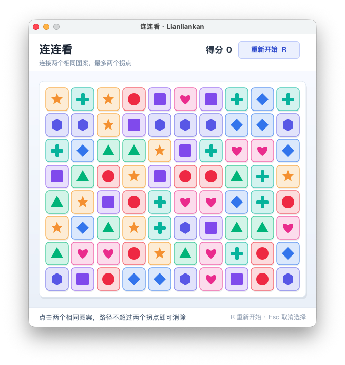
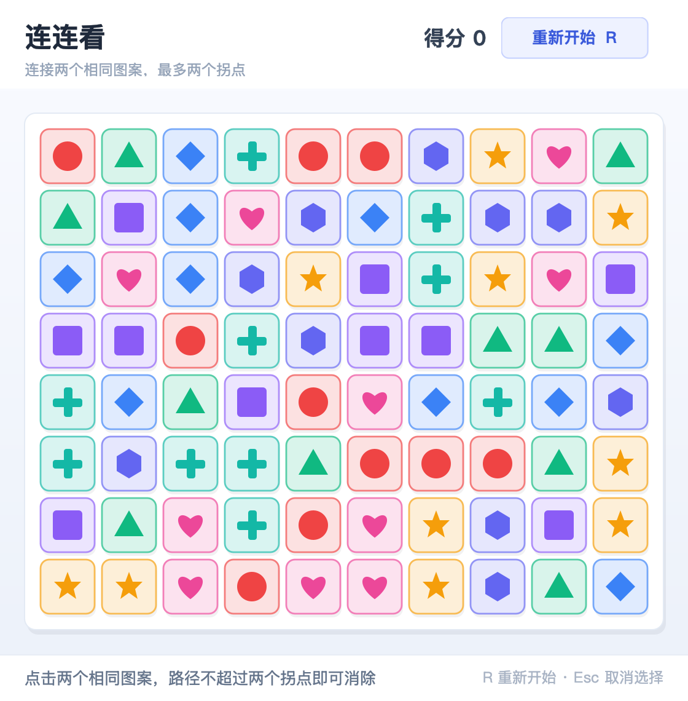
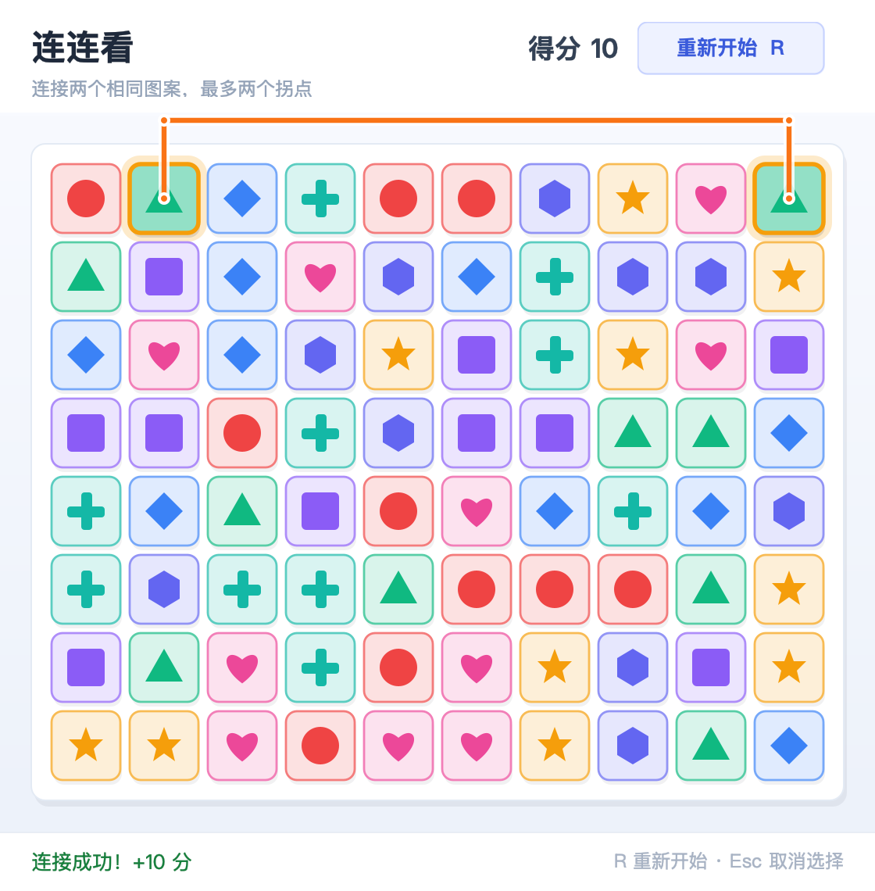
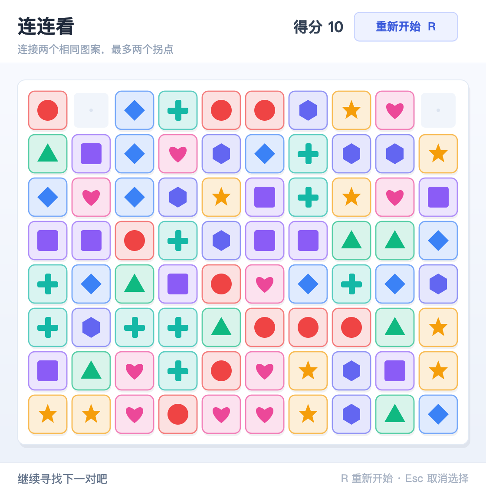

# 连连看（Java Swing）

使用 Java 标准库（Swing / AWT）实现的简易连连看游戏，零第三方依赖，兼容 JDK 8 及以上。

实际运行窗口：



初始棋盘：



## 环境要求

- JDK 8 或以上（`javac`、`java` 在 `PATH` 中）
- 有图形桌面环境（Windows、macOS 或带桌面的 Linux）

## 编译与运行

在仓库根目录执行：

```bash
javac -encoding UTF-8 linkgame/Lianliankan.java
java linkgame.Lianliankan
```

游戏本体集中在单文件 `linkgame/Lianliankan.java` 中，包含 `main` 方法。编译生成的 `.class` 文件已在 `linkgame/.gitignore` 中忽略。

## 操作

| 操作 | 作用 |
| --- | --- |
| 鼠标左键 | 选中一个图案；选中后再次点击同一格取消选择 |
| `Esc` | 取消当前选择 |
| `R` / “重新开始”按钮 | 重开一局 |

## 玩法与规则

- 棋盘为 8 行 × 10 列，每格 50×50 像素，共 8 种彩色几何图案；每种图案数量为偶数（各 10 个）。
- 依次点击两个相同图案，若能用横线/竖线连接且拐点不超过 2 个，即可消除并 +10 分。
- 路径可以绕到棋盘外侧，但不能穿过尚未消除的格子。
- 每次消除后若剩余图案无可行解，会自动重排剩余图案；棋盘清空即通关并显示最终得分。
- 自动重排会保留剩余图案的种类和数量：优先随机重排，必要时构造一对相邻的同图案作为兜底，保证重排后至少存在一步可消。

## 界面

| 选中并显示连接路径 | 消除后 |
| --- | --- |
|  |  |

路径和消除后的截图来自实际运行的 Swing 界面（同一窗口、同一随机棋盘，按 2 倍尺寸导出）。

## 核心实现

- **连通判定**：先试直线（0 拐点），再试两个 L 形拐点（1 拐点），最后枚举起点行/列上的空格作为第一个拐点，再对剩余部分做一次“最多 1 拐点”判定，因此总拐点数不超过 2。判定使用带一圈外边框的坐标，所以允许路径从棋盘外侧绕行。
- **消除与计分**：第二次点击匹配成功后先显示连接路径约 340ms，再移除格子并 +10 分；不匹配或不可连通时两个格子短暂闪红，并在状态栏给出提示。
- **自动重排**：死局检测使用 `hasAnyMove()`；重排保留图案数量与种类，见上。
- **胜负判断**：消除后棋盘为空即通关；自动重排成功后继续游戏，只有无法构造可解布局时才结束。

## 自检

`LianliankanTest.java` 不启动窗口，直接验证核心规则，适合在命令行或 CI 中运行：

```bash
javac -encoding UTF-8 linkgame/Lianliankan.java linkgame/LianliankanTest.java
java linkgame.LianliankanTest
```

输出示例：

```text
全部 2351 项逻辑自检通过
```

自检覆盖直线、L 形、两拐点连通、棋盘外侧绕行、与 BFS 参考实现的完整性对比、死局检测、自动重排、计分、选中/取消和胜利状态等。

## 代码结构

- `Lianliankan.java`：单文件实现，包含纯规则引擎 `GameEngine`、界面 `GamePanel` 和入口 `main`。
- `LianliankanTest.java`：无界面自检，不依赖 JUnit 等第三方库。
- `screenshots/`：实际运行界面的截图；`before-baseline.png` 是基线 `main` 尚无本模块时的终端证据。

## 可扩展点

- **计时 / 步数**：记录开局时间、用时和步数，通关时显示成绩；
- **提示功能**：基于 `hasAnyMove()`、`findPath()` 找到一对可消图案并高亮；
- **难度选择**：调整 `ROWS`、`COLS`、`KIND_COUNT`，或增加限时模式；
- **音效与动画**：为选中、消除、通关增加音效和更丰富的路径动画；
- **排行榜 / 存档**：本地保存最高分，或增加关卡进度。
