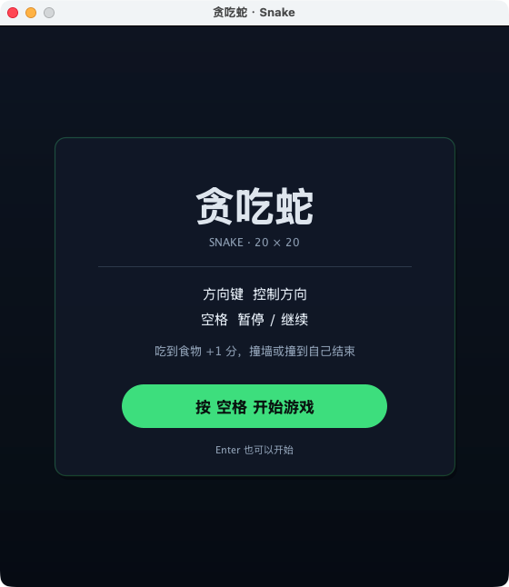
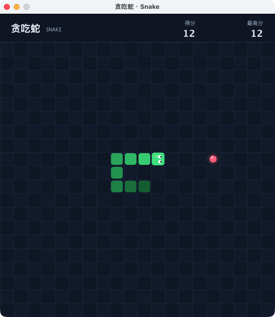
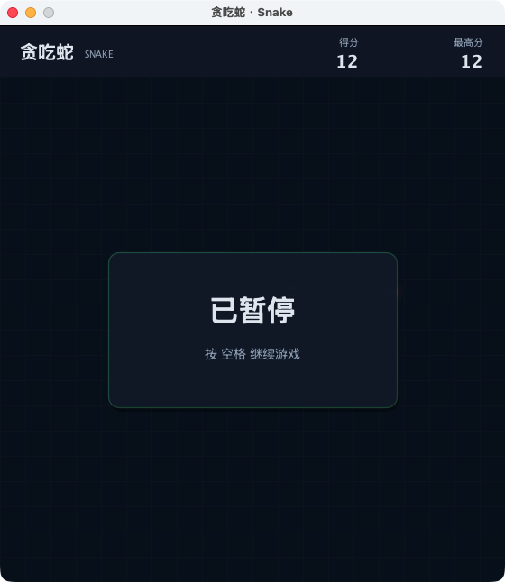
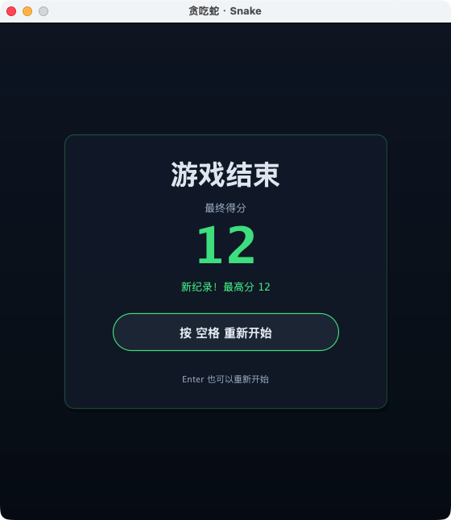

# 贪吃蛇（Java Swing）

使用 Java 标准库（Swing / AWT）实现的简易贪吃蛇游戏，零第三方依赖，编译后可直接运行。



## 环境要求

- JDK 8 或以上（`javac`、`java` 可用）
- 有图形桌面环境（Windows、macOS 或带桌面的 Linux）

## 编译与运行

在 `snake/` 目录中执行：

```bash
javac SnakeGame.java
java SnakeGame
```

也可以从仓库根目录直接编译运行：

```bash
javac snake/SnakeGame.java
java -cp snake SnakeGame
```

如果系统默认编码不是 UTF-8，编译时加上 `-encoding UTF-8`：

```bash
javac -encoding UTF-8 SnakeGame.java
```

编译后会生成 `SnakeGame.class`、`SnakeGame$*.class` 等文件（已在 `snake/.gitignore` 中忽略）。

## 操作

| 按键 | 作用 |
| --- | --- |
| ↑ ↓ ← → | 控制蛇的方向，不能 180° 掉头 |
| 空格 | 开始游戏；游戏中暂停 / 继续；结束后重新开始 |
| Enter | 开始游戏 / 结束后重新开始 |

## 玩法

- 棋盘为 20 × 20 网格，蛇的初始长度为 3，从棋盘中央向右出发。
- 吃到食物后长度 +1、得分 +1，食物会随机出现在空白格中。
- 撞到墙壁或撞到自己时游戏结束，并显示本局最终得分。
- 移入本 tick 即将离开的尾巴格不算撞到自己。
- 最高分只在本次运行期间保留。

## 界面

| 游戏中 | 暂停 | 游戏结束 |
| --- | --- | --- |
|  |  |  |

## 自检

`SnakeGameTest.java` 不启动窗口，直接验证游戏核心规则，适合在命令行或 CI 中运行：

```bash
javac SnakeGame.java SnakeGameTest.java
java SnakeGameTest
```

输出示例：

```text
SnakeGameTest: 127 项检查全部通过
```

## 代码结构

- `SnakeGame.java`：单文件实现，包含纯游戏状态 `Game`、界面 `GamePanel` 和入口 `main`。
- `SnakeGameTest.java`：无界面自检，覆盖初始状态、移动、吃食物、反向限制、撞墙、撞自己、尾巴规则和食物生成。
- `screenshots/`：开始、游戏、暂停、结束界面的实际运行截图。
